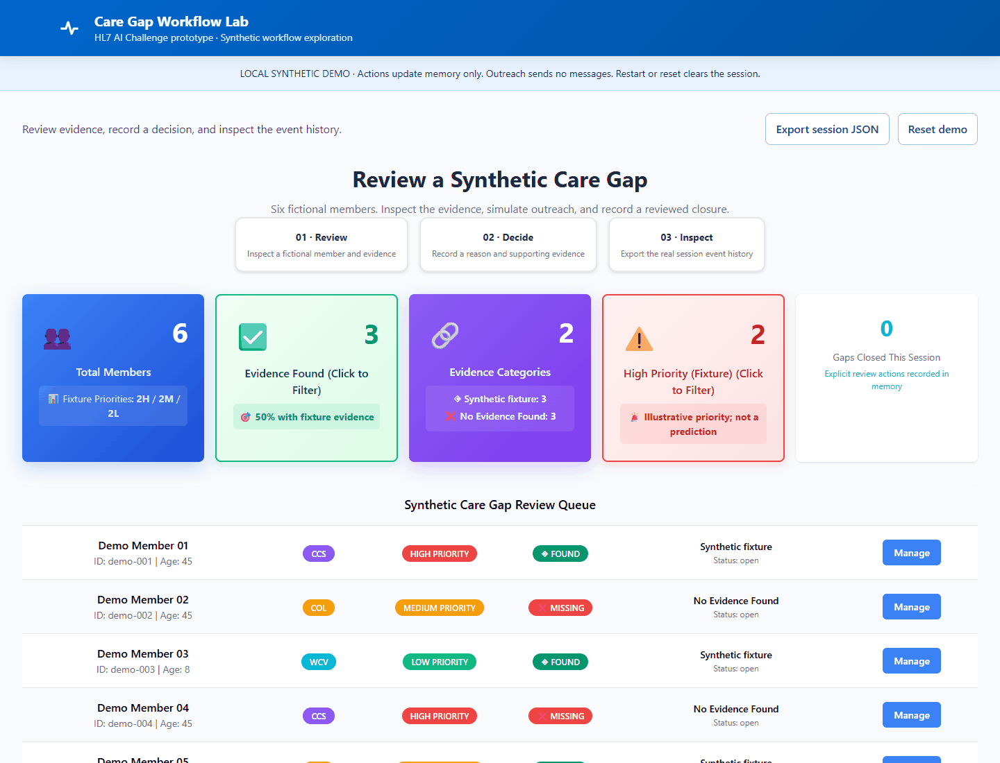

# Care Gap Workflow Lab

[](https://github.com/smgpulse007/hl7-ai-challenge/actions/workflows/demo.yml)

**An inspectable care-management workflow, from evidence review to an exportable decision record.**

Explore six fictional members, filter the review queue, simulate outreach, and close a gap with an explicit reason and evidence. The local API really changes session state: the dashboard count and exported event history reflect your actions. Repeated closure requests do not create duplicate events.



The recording uses the running React UI and Express API. All fixtures are synthetic; outreach sends no messages. [Recording details](docs/local-demo.md#recording-the-demo).

## Run it locally

Install **Node.js 22.12 or newer** with npm, then:

```sh
git clone https://github.com/smgpulse007/hl7-ai-challenge.git
cd hl7-ai-challenge
npm run setup:demo
npm run build:demo
npm run demo
```

Open **http://127.0.0.1:4177**. No Docker, API key, model download, database, or message broker is needed for this workflow. For an existing checkout, start the npm commands from its root.

1. Select **Manage** for a fictional member and inspect the fixture evidence.
2. Choose **Simulate Text Outreach** to record an event. Nothing is sent externally.
3. Enter a synthetic review reason and evidence, then **Record Reviewed Closure**.
4. **Export session JSON** to inspect what happened. **Reset demo** restores the six open gaps.

State exists only in the server's memory and is shared by browser tabs connected to that process. Restart/reset clears it. Export first to retain your synthetic session. Use fictional notes only.

## What you can learn and extend

- A UI/API contract with honest action receipts, visible errors, and state that survives page refresh within the session.
- Review-before-closure validation, duplicate closure handling, bounded event history, reset, and JSON export.
- A small default dashboard bundle that excludes historical scenario screens.
- Real HTTP regressions and clean-install/build checks on Windows and Linux.

This is a workflow prototype, not clinical software. Priority scores and evidence are fixed fixtures; it does not infer clinical risk, adjudicate a quality measure, or demonstrate patient outcomes. It has no production identity, durable database, EHR integration, or clinical validation.

## Verify your change

```sh
npm test
npm --prefix services/care-orchestration run lint
npm run build:demo
node scripts/smoke-demo.cjs
```

Tests send real HTTP requests to ephemeral localhost servers. They cover closure state/counts, repeats, invalid evidence, unknown members, simulated outreach, reset, separate instances, origin/Host restrictions, body size, and event limits. The smoke command verifies the built dashboard and a closure through the API. CI also builds the historical dashboard and audits both Node production dependency trees; it publishes no images or packages.

See [local architecture, API, troubleshooting, and recording](docs/local-demo.md).

## The wider HL7 challenge prototype

The repository preserves the original HL7 AI Challenge 2025 work: Python HL7/FHIR processing, a risk service with external XGBoost loading hooks and synthetic dummy-model fallback, RabbitMQ orchestration, Compose files, and historical scenario screens. These are separate from the lightweight workflow above.

The full multi-service stack remains an advanced, unverified path in this repair. It requires further integration work and external NLP/model dependencies. Historical figures, submission documents, SMART/CDS aspirations, throughput, ROI, and outcome figures are not verified results or conformance certification. The public tree does not contain the trained clinical models described in those materials.

Source: [HL7/FHIR service](services/hl7-processing), [risk service](services/risk-prediction), [legacy orchestration](services/care-orchestration/app.js), [historical architecture](docs/architecture.md). The [deployment guide](DEPLOYMENT_GUIDE.md) and submission artifacts are historical references, not the tested quickstart.

## Contributing

Useful next contributions include synthetic failure cases, persistent demo-state adapters, and evidence-backed interoperability tests. Keep real patient data, credentials, and employer material out of fixtures and recordings. Explain what each test establishes and its limits.

The repository includes an existing [MIT license](LICENSE); historical service metadata and attribution are preserved.
